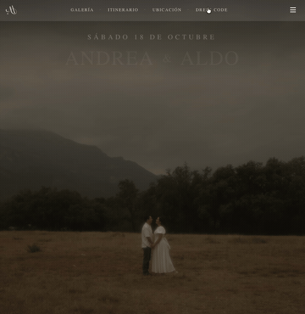

<div align="center">

# Andrea & Aldo



_A wedding invitation with a cinematic entrance, photo gallery, and WhatsApp RSVP. October 18, 2025._

</div>

Develop from source with Node.js 20 or later:

```bash
git clone https://github.com/AlejoReyna/Andrea-y-Aldo.git
cd Andrea-y-Aldo
npm ci
npm run dev
```

Open [localhost:3000](http://localhost:3000).

<sub>[Live invitation](https://thewedding-omega.vercel.app/)</sub>
